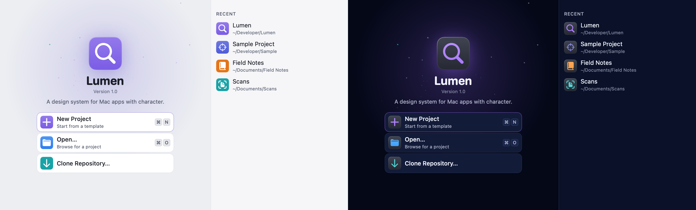
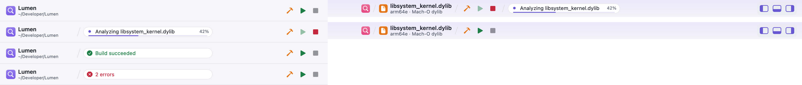
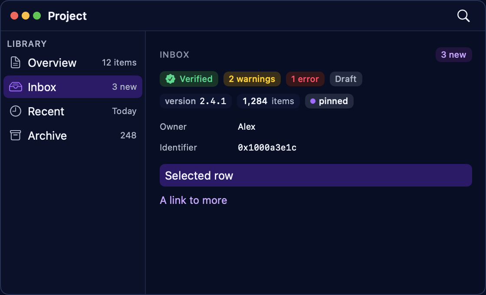
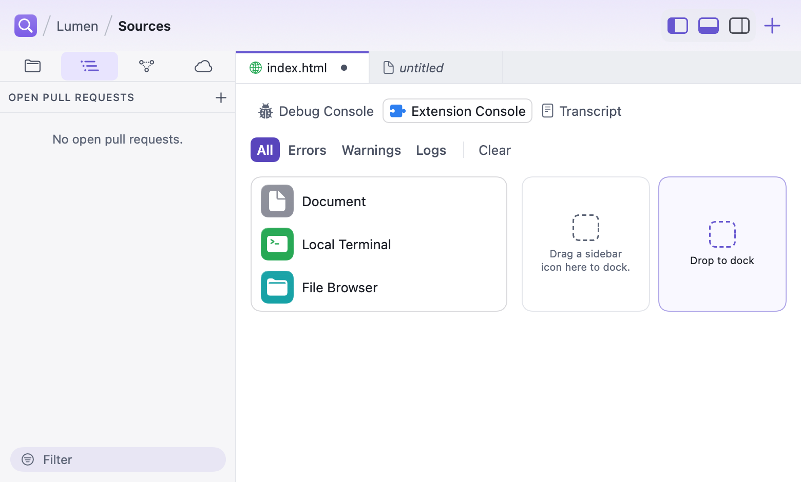

# Lumen

**Native SwiftUI components, editable themes, and reusable design tokens for macOS applications.**

Lumen gives related Mac applications a shared visual foundation while allowing each app to keep its own identity. Define semantic color roles and app-specific packs, compose interfaces from the component library, and let users import and edit themes. A standalone Catalog demonstrates the components in working windows, menus, inspectors, and workspace layouts.

[Explore the components](#components) · [Add Lumen to an app](#adding-lumen-to-an-app) · [Architecture](Docs/ARCHITECTURE.md) · [Changelog](CHANGELOG.md)

Use **LumenTokens** for UI-independent theme data and validation, **LumenUI** for SwiftUI integration, and the **Lumen Catalog** to explore the system in working examples. The existing validator checks defined text and control color pairings in light, dark, and Increase Contrast appearances.

- **macOS 27+**, Swift 6.1+ toolchain, SwiftUI first with AppKit where it matters.
- **Design:** `Design/LumenAppTemplate.icon` and `Design/app-icon-build.py` provide client app icons; `Docs/reference/app-icon.md` covers generation, native checks and appearance previews.
- **`LumenTokens`:** tokens, packs, registry, themes, validator, export. Plain Swift, no UI.
- **`LumenUI`:** theme store, palette environment, metrics, density, components, and the theme
  gallery, editor and library.
- **`LumenConformance`:** checks an app runs in its own tests when updating Lumen: themes,
  layout, shortcuts, color coverage, the workspace window, truncation, icon scale, overflow,
  surface steps, tile backlight, visible duplicates and narrow sizing. Apps add their own
  `LumenCheck` rules and run them with the same context and finding format. For app test targets;
  the Catalog also lists check metadata.
- **`lumen-theme`:** a command-line tool that validates theme files and exports the reference.
- **Lumen Catalog** (`swift run LumenCatalog`): every component in a real Mac app, including native
  menus with Lumen tiles, the command menu, a Settings window with colored tabs, a welcome window,
  a live toolbar, an inspector, popovers, Lumen's glyphs, live pages for forms and controls, search
  and navigation, data and Git, and browsing, and a workspace window. Launch options
  for screenshots and demos: `LUMEN_CATALOG_PAGE=<page>`, `THEME=<theme id>`, `APPEARANCE=light|dark`,
  `CHROME=glass|drawn` (the chrome style, Docs/GLASS.md), `WORKSPACE=1`, `SPLIT=1` (a split workspace), `WELCOME=1`, `SETTINGS=1`, `PALETTE=1|<query>`, `COMMANDS=1`, `POPOVER=1`,
  `LAUNCH=<seconds>`, `DOCK=1`, `PANEL=<tab>`, `INSPECTOR=0`, `ACTIVITY=working`, `SCROLL=bottom` and
  `LOGSTREAM=1` (a log line every 0.3 s), each prefixed `LUMEN_CATALOG_`.
  `LUMEN_CATALOG_PAGE=scale` measures one 10× workload at a time; `LumenScaleTimingTests` writes observations to `.build/lumen-scale-report.json` (collection uses the 1,000-row list reference; no collection budget exists).

  `LUMEN_STRESS=1` opens each archetype window (workspace, utility, library, document) in turn, cycles it
  through minimum size, default size, 1.3 text scale, inactive state and both chrome styles, runs
  `windowStructure(kind:)`, `narrowSizing` and `truncation` where a check can render the state, writes
  `lumen-stress/stress-report.{json,md}` (path on stdout, with the AppKit geometry-fault count per window)
  and quits: `LUMEN_STRESS=1 swift run LumenCatalog`. The Catalog's Overview shows
  which macOS 27 features are active.

  Every `LUMEN_*` variable:

  | Variable | Used by | Effect |
  |---|---|---|
  | `LUMEN_STRESS=1` | Catalog | Run the stress cycle above, write the report, quit |
  | `LUMEN_STRESS_DIR` | Catalog | Where the stress report folder goes |
  | `LUMEN_CATALOG_PAGE=<page>` | Catalog | Open a page directly (`scale` measures one 10× workload) |
  | `LUMEN_CATALOG_THEME=<theme id>` | Catalog | Theme for this launch, not saved |
  | `LUMEN_CATALOG_APPEARANCE=light\|dark` | Catalog | Override the system appearance |
  | `LUMEN_CATALOG_CHROME=glass\|drawn` | Catalog | Chrome style for this launch, not saved |
  | `LUMEN_CATALOG_WORKSPACE=1`, `_SPLIT=1`, `_WELCOME=1` | Catalog | Open the workspace, split workspace or welcome window at launch |
  | `LUMEN_CATALOG_SETTINGS=1` / `_OPEN_SETTINGS=1` | Catalog | Open the Settings window at launch |
  | `LUMEN_CATALOG_SETTINGS_CATEGORIES=2`, `_SETTINGS_SELECTION=<id>` | Catalog | Settings category set and initial selection |
  | `LUMEN_CATALOG_SETTINGS_METRICS=<path>` | Catalog | Write a Settings window measurement report to the path |
  | `LUMEN_CATALOG_TOOLBAR_REPORT=<path>` | Catalog | Write the toolbar item report to the path |
  | `LUMEN_CATALOG_PALETTE=1\|<query>` | Catalog | Open the command palette after launch, with a query |
  | `LUMEN_CATALOG_COMMANDS=1`, `_POPOVER=1` | Catalog | Open the command menu or share popover |
  | `LUMEN_CATALOG_LAUNCH=<seconds>` | Catalog | Open the new menu after a delay |
  | `LUMEN_CATALOG_DOCK=1`, `_PANEL=<tab>`, `_INSPECTOR=0` | Catalog | Workspace dock, bottom panel tab; hide the inspector |
  | `LUMEN_CATALOG_ACTIVITY=working` | Catalog | Start a long task in the toolbar status |
  | `LUMEN_CATALOG_SCROLL=bottom` | Catalog | Scroll the page to its end |
  | `LUMEN_CATALOG_LOGSTREAM=1` | Catalog | Append a log line every 0.3 s |
  | `LUMEN_SCRATCH` | `install-catalog.sh`, `release.sh` | Build scratch path |
  | `LUMEN_RECORD_SNAPSHOTS=1` | tests | Rewrite goldens (reported as a failure) |
  | `LUMEN_GOLDENS_DIR=<dir>` | tests | Record into a scratch folder instead of the goldens |
  | `LUMEN_GOLDEN_THEME=<id>` | tests | Limit golden recording and design-rule checks to one theme |
  | `LUMEN_SKIP_GOLDENS=1` | tests, `release.sh` | Skip golden comparisons (a release refuses it) |
  | `LUMEN_BENCH=1`, `LUMEN_PERF_BUDGET_SCALE=<n>` | tests, Catalog Scale | Print timings; widen every performance budget |
  | `LUMEN_SETTINGS_DIAGNOSTICS_DIR=<dir>` | tests | Write Settings window diagnostics |

Start with [Docs/PRINCIPLES.md](Docs/PRINCIPLES.md) (compatible with macOS, drawn by Lumen) and
[Docs/ARCHITECTURE.md](Docs/ARCHITECTURE.md). Releases and what each changes are in
[CHANGELOG.md](CHANGELOG.md). [Docs/KEYBOARD.md](Docs/KEYBOARD.md) covers keyboard
operation, shortcuts, menu bar commands and click targets. The generated token
reference and theme JSON Schema are in [Docs/reference](Docs/reference).


| Menus: native menus with tiles, and the command menu | Icon tiles: the hue family |
|---|---|
|  |  |












## Components

Every view below appears in the Catalog, on its own or inside a larger one, unless it's marked
(not in the Catalog); where to look is in brackets. The theming and layout lines list the APIs
behind them.

- **Chrome & workspace:** `LumenToolbarIdentity`, `LumenActivityStatus`, `LumenTaskCluster`,
  `LumenToolbarBreadcrumb`, `LumenPanelToggles`, `LumenNewItemButton` with `.lumenLaunchMenu`,
  `.lumenWindowChrome`, `.lumenBottomPanel`, `LumenTopBar`, `LumenSplitEditor`, `LumenDocumentTabBar`,
  `LumenTabOverview`, `LumenStatusBar`, `.lumenFloatingStatus`, `LumenWelcomeView`, `LumenWelcomePanel`,
  `LumenStarfield`, `LumenAppIcon`, `LumenWorkspaceWindow` (with `LumenWorkspacePanels`,
  `LumenTopBarPlacement`; not in the Catalog), `LumenWorkspaceToolbar`, `LumenToolbarStatus`, `LumenToolbarDivider`,
  `LumenToolbarGroup`, `LumenNavigationButtons` (not in the Catalog), `LumenContentTabBar`, `LumenTitlebarBackground`,
  `LumenPanelToggle`, `LumenPanelDeckControls`, `LumenWindowDragArea`, `.lumenTopBar`,
  `.lumenToolbarDimming` (not in the Catalog), `LumenToolbarIconButtonStyle` (`.lumenToolbarIcon`),
  `LumenPanelIconButtonStyle` (`.lumenPanelIcon`, `.lumenPanelIcon(isOn:)`), `LumenDropZone` [Toolbar, Welcome, Workspace, Browse (tab overview), States & Rows, Components; the
  Workspace and Split Workspace windows].
- **Sidebars & panels:** `LumenSourceList`, `LumenSidebarSwitcher`, `LumenSidebarSection`,
  `LumenSidebarCountSection`, `LumenStackedSidebar`, `LumenSidebarPaneGrid`, `LumenFilterField`,
  `LumenPanelTabs`, `LumenPanelBar`, `LumenPanelDeck`, `LumenLogConsole`, `LumenLogFilterBar`,
  `LumenSidebarHeader`, `LumenSidebarActions`, `LumenInspector` pieces (`.lumenInspector`,
  `LumenInspectorHeader`, `LumenInspectorRow`, `LumenInspectorToggle`, `LumenInspectorPane`,
  `LumenInspectorSection`, `LumenInspectorSummary`, `LumenReferenceRow`), `.lumenInspectorEmptyState`
  (not in the Catalog), `LumenStatusMenu` [Workspace, Components, States & Rows,
  Editor; the Workspace and Split Workspace windows].
- **Settings & forms:** `.lumenSettingsTab`, `LumenSettingsPane`, `LumenSettingsSidebarView`,
  `LumenSettingsRow` (with a badge), `LumenSettingsCard`, `LumenSentenceRow`, `LumenNumberField`,
  `LumenCheckboxGrid`, `LumenDependentGroup`, `LumenInheritedPicker`, `LumenIntegrationRow`,
  `LumenListEditor`, `LumenMasterDetail`, `LumenFieldList`, `LumenWizardStep`, `LumenManagedToolRow`,
  `LumenAppearanceSettings`, `LumenSettingsHeader`, `LumenSheet`, `LumenFormSection`, `LumenFormRow`,
  `LumenFieldRow`, `LumenInlineField`, `LumenFlowLayout` [Settings, Sheets & Settings, Forms & Controls].
- **Controls & editors:** `LumenSwitch`, `.lumenCheckbox` (`LumenCheckboxStyle`), `LumenRadioGroup`,
  `LumenRadioButton`, `LumenTabbedBox`, `LumenTable` (`LumenTableText`), `LumenSlider`, `LumenTextField` (not in the Catalog),
  `LumenComboField`, `LumenPopUp`, `LumenPopUpLabel`, `LumenPullDownButton`, `LumenKeyValueEditor`,
  `LumenRuleEditor`, `LumenModeSwitcher`, `LumenHelpButton`, `LumenInfoButton`, `LumenHuePickerButton`,
  `LumenHueSwatchPicker`, `LumenColorWell`, `LumenColorGrid`, `LumenSwatchStrip`, `LumenSwatchMenuLabel`,
  `LumenIconPicker`, `LumenPermissionsGrid`,
  `LumenFontPicker`, `LumenCodeFontPicker`; button styles `.lumenPrimary`, `.lumenQuiet`, `.lumenTinted`,
  `.lumenPlain` [Forms & Controls, Popovers, States & Rows, Debugger].
- `LumenDateField`: native date editing with a stepper or graphical popover on a Lumen field.
- `LumenTimeField`: native time editing with an optional full-date range.
- `LumenStepper`: a formatted, bounded Double value with increment and decrement controls.
- `LumenTokenField`: removable chips, comma/Return entry, and optional suggestions.
- `LumenTable`: optional caller-owned sort order and resizable columns, with horizontal overflow preserving widths and minimums.
- `LumenRichTextView`: a themed native attributed-text field that grows then scrolls, with an optional compact formatting bar.
- `LumenSegmentedControl`: form-sized text, glyph, or combined segments with filled selection.
- **Search & navigation:** `.lumenCommandPalette` with `LumenPaletteScope`, `LumenCommandMenu`,
  `LumenMenuLabel`, `LumenFindPanel`, `LumenSearchResults`, `LumenHighlightedText`,
  `LumenInputPalette` with `LumenGoToLine` (`.lumenInputPalette`; `.lumenGoToLine` isn't in the Catalog),
  `LumenCompletionList`, `LumenShortcutRecorder`, `LumenShortcut`, `LumenShortcutGroup`,
  `LumenShortcutsSheet`, `.lumenShortcutsSheet`, `LumenShortcutsCommands` (Help › Keyboard Shortcuts, ⌘/),
  `LumenFilterChips`, `LumenAddressField`, `.lumenCommandMenu`, `.lumenPanelCommands`, `.lumenPaneCommands`,
  `.lumenMenuOwnsShortcuts`, `.lumenFocusRing`, `LumenViewCommands` (see Docs/KEYBOARD.md) [Menus, Search & Navigation, ⌘K anywhere; the Split Workspace
  window].
- **Data & history:** `LumenNoticeCard` and `.lumenNotices`, `LumenOutlineControls`, `LumenHistoryRow`,
  `LumenRefPill`, `LumenAvatar`, `LumenComparisonHeader`, `LumenDiffNavigator`, `LumenMinimap`,
  `LumenChecklistTree`, `LumenCommitComposer`, `LumenStatsCard` (`LumenStatCell`) [Data & Git; the Split Workspace window].
- **Debugger & code:** `LumenStackFrameList`, `LumenRegisterGrid`, `LumenConsole`, `LumenBreakpointRow`,
  `LumenHexDump`, `LumenCommandField`, `LumenWatchList`, `LumenVariableTree`, `LumenCodeListing`,
  `LumenStatusStrip`, `LumenBranchLanes`, `LumenStringRow`, `LumenStringLiteral`, `LumenGraphNode`
  (`LumenGraphEdgeKind`, `LumenGraphEdgeBadge`), `LumenProcessList`, `LumenVariableRow`,
  `LumenEvaluationResult`, `LumenBreakpointMarker`, `LumenProgramCounterMarker`, `.lumenListingRow`
  (`LumenListingRowState.patchMark`), `LumenHexStyle`, `.lumenCodeFont` (`LumenCodeFont`), `LumenLineNumberRuler` (AppKit)
  [Debugger, Editor, Sheets & Settings].
- **Browse:** `LumenCollection` and `LumenCollectionControls`, `LumenCarousel`, `LumenItemCard`,
  `LumenDetailHeader` [Browse].
- **States & feedback:** `LumenBadge`, `LumenPill`, `LumenTag`, `.lumenTagTint` (not in the Catalog), `LumenCount`,
  `LumenSectionHeader`, `LumenSymbol`, `LumenSymbolBadge`, `LumenSentenceText`, `LumenKeycap`, `LumenEmptyState`
  (`LumenEmptyState.Prominence` `.inline`/`.pane`, `LumenEmptyState.inline(_:ink:leading:padding:)`,
  `.lumenEmptyMessage`), `LumenEmptyHero`, `LumenBanner`, `LumenToast`, `LumenToastCenter`, `.lumenToasts`, `LumenLoadingState`, `LumenErrorState`, `LumenProgressBar`,
  `LumenProgressRing`, `LumenListRow` (`LumenRowState`, `.lumenRowBackground`), `LumenPropertyRow`,
  `LumenStatusRow`, `LumenCodeSample`, `LumenStatusLabel`, `.lumenPopover` (`LumenPopoverContent`), `.lumenCompactControl`
  (not in the Catalog), `LumenIconTile`, `LumenGlyph` (`LumenGlyphView`) [Components, States & Rows, Forms & Controls, Popovers,
  Icon Tiles, Glyphs].
- **Theming:** `LumenThemeStore`, `.lumenPaletteRoot`, `.lumenMetrics`, `.lumenDensityRoot`,
  `.lumenSurface`, `LumenThemeGallery` (with `LumenThemeCard`, `LumenThemeMiniature`, `LumenThemeEditor`
  and theme import), `LumenUserThemeLibrary`, `LumenShowcase` [Themes].
- **Surfaces & depth:** `.lumenCard`, `.lumenRaisedGround`, `.lumenElevation` (`LumenElevation`),
  `.lumenGlow`, `.lumenTileBacklight`, `.lumenAmbientWash` (`LumenAmbientWash`) [Components, Welcome,
  Workspace].
- **Layout and rules:** `LumenLayout`, `.lumenColumn`, `.lumenSidebarColumn`, `.lumenSidebarBackground`,
  `.lumenColumnContent`, `.lumenFixedContainer`, `.lumenNeverTruncates`, `.lumenWrapsWithoutTruncating`,
  `.lumenIconRole`, `.lumenIconOnlyControl`, `.lumenRendersOffscreen`, `LumenSnapshot` (offscreen
  renders for goldens; `LumenSnapshot.Renderer` `.image` or a never-shown `.window`);
  the checks that read them are in `LumenConformance` (used throughout the Catalog).

## Concepts in one minute

- A **token** is a color role: `bg.canvas`, `fg.secondary`, `accent.default`. Lumen's core pack
  defines the roles every app shares: surfaces, text, accent, status, the hue family, window
  chrome, menus, panels, the welcome window and the workspace (the full list is in
  [Docs/reference](Docs/reference), which covers the core pack only). Optional packs add code and
  syntax roles (`LumenPack.code`) and chart series (`LumenPack.chart`). Your app adds its own roles
  in a **pack**.
  - `LumenPack.code` (`LumenToken.Code`, 18 roles): `syntax.keyword`, `.type`, `.function`,
    `.variable`, `.string`, `.number`, `.comment`, `.operator`, `.punctuation`; `code.currentLine`,
    `.programCounter`, `.selection`, `.lineNumber`; `diff.addedBackground`, `.removedBackground`,
    `.changedBackground`, `.addedForeground`, `.removedForeground`.
  - `LumenPack.chart` (`LumenToken.Chart`, 11 roles): `chart.series1` … `chart.series8`,
    `chart.grid`, `chart.axis`, `chart.label`.
  - Their specs (fallbacks, contrast) and built-in values are in `Sources/LumenTokens/LumenPacks.swift`.
- Each token has a **spec**: its group, its fallback (a semantic role every theme defines, or a
  default such as another role or a tint over a background), the **surface** whose theme draws
  it, and the contrast it must reach.
- A **theme** is JSON. It usually `inherits` a built-in and overrides a few colors. Unknown keys
  are kept, so one theme file works across apps.
- The **validator** checks every theme against every spec and rule. The theme editor, the
  gallery and import all use it.

## Adding Lumen to an app

Add the package dependency and import `LumenUI` in your window content.

```swift
// Package.swift
.package(url: "https://github.com/jdotc1/LumenUI", from: "0.62.1")
// target
.product(name: "LumenUI", package: "Lumen")
```

### Your app's pack

```swift
import LumenTokens

extension LumenToken {
    static let paperHeader: LumenToken = "paper.header"
}

extension LumenPack {
    static let myApp = LumenPack(
        id: "com.example.myapp",
        tokens: [
            LumenTokenSpec(.paperHeader, group: "Paper", fallback: .composite(.accent, alpha: 0.06, over: .bgCanvas)),
        ],
        themes: [/* your branded themes, usually inheriting lumen.standard */]
    )
}

let registry = LumenRegistry(packs: [.core, .myApp])
```

### Install the store and apply the root modifiers

```swift
import LumenUI

@main struct MyApp: App {
    init() {
        LumenThemeStore.install(LumenThemeStore(
            registry: registry,
            configuration: LumenStoreConfiguration(appName: "MyApp", defaultThemeID: LumenThemes.standardID)
        ))
    }

    var body: some Scene {
        WindowGroup {
            ContentView()
                .lumenPaletteRoot()              // measured chrome gap, minimum sizing and reachable overflow
                .lumenMetrics(.standard)          // or your app's metrics: fonts, spacing, corners
                .lumenDensityRoot()
        }
        Settings { LumenSettingsSidebarView(settingsCategories) }.lumenSettingsScene()
    }
}
```

Then draw with roles, not colors:

```swift
Text("Signed").foregroundStyle(.lumen(.statusSuccess))
LumenBadge("3 warnings", tone: .warning)
LumenEmptyState(systemImage: "doc", title: "No documents", message: "Import a document to begin.")
LumenEmptyState("No matching documents", prominence: .inline)          // an empty list: one quiet sentence
```

Expressive pieces, all theme-driven:

```swift
LumenIconTile("paintpalette.fill", hue: .hueViolet, size: 40)           // System Settings-style tile
Button {} label: { LumenMenuLabel("Open Recent", systemImage: "clock.fill", hue: .hueOrange) }  // in a native Menu
LumenCommandMenu(entries)                                                // quick actions, submenus, keycaps
GeneralPane().lumenSettingsTab("General", systemImage: "gearshape.fill", hue: .hueGraphite)  // Settings tab
LumenSettingsPane("General", systemImage: "gearshape.fill", hue: .hueGraphite, summary: "…") { /* native Form rows */ }
```

### Settings: compose the complete window

```swift
Settings { LumenSettingsSidebarView(categories) }.lumenSettingsScene()
```

Use `LumenAppearanceSettings(textScale: $textScale, showsGallery: false)` for an app-owned text-scale row (optional `store:` and `textScaleSteps:`).

Supply `[LumenSettingsCategory]`, each with its pane content. The stock scaffold owns the searchable
source-list sidebar and palette surfaces, category tiles, Back/Forward history (⌘[ / ⌘]), matching
icon-only sidebar toggle, category navigation title, balanced split and stable window frame. The
Scene helper sets native compact toolbar behavior and window defaults; the scaffold applies its
own palette tint.
Both `.drawn` and `.glass` use the same complete window, including apps with only two categories.
`LumenSettingsPane` keeps its tile, title and summary and bounds both `.rich` and `.grouped` content.

Don't rebuild the window from parts or wrap it in another split view. Never add a labeled
“Sidebar” toolbar button, a principal “Settings” title, a hidden-titlebar recipe or extra toolbar
padding. The category title belongs beside Back/Forward in the chrome; its pane header remains
in the content. Use the scaffold's selection API for deep links and
`.lumenSettingsQuery(_:)` when embedding settings rows in another search context. The Catalog's
real Settings window (⌘,) demonstrates this recipe, including the sparse two-category case and
an Engine sample built from public rows; the tabbed sample remains on its Catalog page.
See `Docs/reference/settings.md` for category definitions, selection hooks and window composition.

A welcome window and a toolbar with live task state:

```swift
Window("Welcome to Field Notes", id: "welcome") {
    LumenWelcomeView(appName: "Field Notes", version: "2.1", tagline: "Notes from the field, in order.",
                     markSymbol: "book.closed.fill", markHue: .hueOrange,
                     actions: [LumenWelcomeAction("New Notebook", systemImage: "plus", hue: .hueOrange,
                                                  shortcut: KeyboardShortcut("n"), isPrimary: true) { newNotebook() }],
                     recents: recents, showAtLaunch: $showWelcome) { open($0) }
        .lumenPaletteRoot()
}
.windowStyle(.hiddenTitleBar)
.windowResizability(.contentSize)

// In the main window. The toolbar stays native; Lumen fills its items.
.toolbar {
    ToolbarItem(placement: .navigation) { LumenToolbarIdentity("Field Notes", subtitle: path, systemImage: "book.closed.fill", hue: .hueOrange) }
    ToolbarItem(placement: .principal) { LumenActivityStatus(activity) }    // .idle(), .working(…, progress:), .succeeded("…"), .failed("…")
    ToolbarItem(placement: .primaryAction) { LumenTaskCluster(tasks, activity: activity) }  // start and stop follow the activity
}
```

For a split view, share its visibility binding with the sidebar modifier:

```swift
@State private var columns: NavigationSplitViewVisibility = .all

NavigationSplitView(columnVisibility: $columns) {
    sidebar.lumenSidebarToggle(columnVisibility: $columns)
} detail: {
    detail
}
```

The resolved chrome style chooses a bare outline button matching the inspector in `.drawn` and the system
sidebar toggle in `.glass`, including runtime changes. Native sidebar menu commands still work.
Apply `.lumenToolbarPlatter(chromeStyle)` to your other toolbar items. A `ToolbarItem` containing
`LumenToolbarIdentity` directly automatically stays bare in both styles; keep identities in their
own item, separate from control groups. For a status that yields
space before controls overflow, use `LumenToolbarStatus(activity, minWidth: 180)`
after the identity with `.navigation` placement. It measures the full label and percentage, then
limits the capsule to the room left by the live native toolbar items, including AppKit's spacing.
Only a shortage of room causes middle truncation; at the minimum, native overflow applies.
The older `idealWidth:minWidth:` initializer forwards to this behavior and is deprecated.
Existing `width:` initializers retain their behavior.

An inspector and popovers. Both stay native (`.inspector`, `.popover`); Lumen lays out what's inside:

```swift
.lumenInspector(isPresented: $showsInspector) {                          // ⌥⌘I via LumenInspectorToggle
    LumenInspectorHeader("Survey", subtitle: "Notebook", systemImage: "book.closed.fill", hue: .hueOrange)
    LumenInspectorSection("Appearance", systemImage: "paintpalette.fill", hue: .huePink) {
        LumenInspectorRow("Color") { LumenHuePickerButton(selection: $hue) }    // swatches in a popover
        LumenInspectorRow("Pages") { Stepper("Pages", value: $pages) }         // native controls
    }
}
LumenInfoButton("Sync", message: "Notebooks sync when the Mac is on power.")  // ⓘ with an explanation
Button("Share…") { sharing = true }
    .lumenPopover(isPresented: $sharing, title: "Share Notebook", systemImage: "square.and.arrow.up.fill", hue: .hueBlue) { … }
```

A workspace window: the title bar glows while the window is active, panel toggles show
which regions are open and slide them in and out, and the panes carry their own tabs, filters and
consoles. The structure stays native (NavigationSplitView, `.inspector`, the toolbar, menus, tables):

```swift
NavigationSplitView { sidebar } detail: {
    editor
        .lumenBottomPanel(isPresented: $showsPanel) {                       // slides, resizes by its top edge
            LumenPanelTabs(selection: $tab, tabs: tabs)                      // capsule tabs, hued icons
            LumenLogConsole(entries) { entries = [] }                        // source menu, filter, level chips, Clear, native table
        }
        .inspector(isPresented: $showsDock) { LumenDropZone() }
}
.toolbar {
    ToolbarItem(placement: .navigation) { LumenToolbarBreadcrumb(["Lumen"], systemImage: "lumen.lens", hue: .hueViolet) }
    ToolbarItem(placement: .primaryAction) {
        LumenPanelToggles(leading: $showsSidebar, bottom: $showsPanel, trailing: $showsDock)  // ⌃⌘S ⇧⌘Y ⌥⌘I
    }
    ToolbarItem(placement: .primaryAction) {
        LumenNewItemButton { showsNew = true }.lumenLaunchMenu(isPresented: $showsNew, items: newItems)
    }
}
```

A single-window utility uses `LumenUtilityWindow`: the same unified top-bar placement, optional
source list and inspector, a content pane, and optional bottom status items. The scaffold supplies
`LumenInspector` and `LumenStatusBar`; their builders supply sections and items. The companion
scene helper puts the native toolbar on the window buttons’ line and enforces the root’s minimum.

```swift
@State private var panels = LumenUtilityPanels()

// In the app's Scene builder:
Window("File Utility", id: "utility") {
    LumenUtilityWindow(panels: $panels, minimumSize: CGSize(width: 640, height: 400)) {
        fileTable
    } sidebar: {
        sourceList
    } inspector: {
        LumenInspectorSection("Tags") { tagRows }
    } statusBar: {
        Text("Reviewing files")
        LumenProgressBar(0.5).frame(width: 96)
    } topLeading: {
        LumenToolbarIdentity("File Utility", systemImage: "doc.on.doc", hue: .hueTeal)
    }
    .contentMinimumWidth(640)
    .lumenPaletteRoot()
}
.lumenUtilityScene()
.commands { LumenViewCommands() }
.defaultSize(width: 1120, height: 680)
```

Without a `panels` binding, regions start automatic. The inspector collapses first, then the
sidebar, and they restore in reverse order when space returns. Toolbar and menu choices are
explicit; supplying a binding makes both regions explicit. Hidden regions stay hidden, while
explicitly shown regions collapse after automatic ones, always before content clips. Resizing
never changes the requested state.

Leave out any optional builder the utility does not need; its toggle is omitted too. The minimum
size is the content area, excluding the native top bar. Match it to the content, toolbar and status
items. `LumenConformance.windowStructure(kind: .utility, sizes: sizes) { utilityView }` checks the
real native window. `windowStructure(kind:)` also supplies a check for the conformance runner;
`.workspace` and the existing `workspaceWindow` entry point share that checker. The kind is an
extensible value type, so later archetypes add static kinds without breaking exhaustive switches.
The Catalog’s **Utility Window** entry opens a complete example with generic file and tag data.

A library/browser uses `LumenLibraryWindow`, with source collections, filter chips above the
content, a trailing detail pane and optional status items. Search and filter controls occupy the
native top bar. The detail builder starts with `LumenDetailHeader`; the scaffold supplies its
scrolling surface. Put a long `LumenCollection` in a scroll view:

```swift
@State private var libraryPanels = LumenLibraryPanels()
@State private var query = ""
@State private var filter = "All"
@State private var selectedImage: String?
@State private var sort = LumenCollectionSort.title

Window("Image Library", id: "library") {
    LumenLibraryWindow(panels: $libraryPanels, minimumSize: CGSize(width: 640, height: 400)) {
        ScrollView {
            LumenCollection(filteredImages, mode: .grid, size: 100,
                            selection: $selectedImage, sort: $sort) { selectedImage = $0.id }
                .frame(minWidth: 0, maxWidth: .infinity)
                .lumenColumnContent("Image grid")
        }
    } sourceList: {
        collections
    } detail: {
        LumenDetailHeader("Image", systemImage: "lumen.imageSeries", hue: .hueBlue)
        metadata
    } filterChips: {
        LumenFilterChips(selection: $filter, options: ["All", "Favorites"], title: { $0 })
    } statusBar: {
        Text("\(filteredImages.count) images")
    } topLeading: {
        LumenToolbarIdentity("Library", systemImage: "lumen.imageSeries", hue: .hueBlue)
    } topCenter: {
        LumenFilterField(text: $query, prompt: "Search images").frame(width: 160)
    } topTrailing: {
        LumenPopUp(selection: $filter, options: ["All", "Favorites"], title: { $0 })
    }
    .columnWidths(sourceList: (180, 200, 280), detail: (260, 280, 380))
    .lumenPaletteRoot()
}
.lumenLibraryScene()
.defaultSize(width: 1200, height: 720)
```

The host derives `filteredImages` from the query, collection and filter selections. Library panes
reuse the utility collapse policy unchanged: detail first, then source list, with reverse
restoration and persistent explicit intent. Optional builders can be omitted. The **Library
Window** Catalog entry demonstrates 40 generic images, sparse content and both chrome styles.
`LumenConformance.windowStructure(kind: .library, sizes: sizes) { libraryView }` includes the shared
structure checks and detail-before-source collapse reporting. See `Docs/reference/library-window.md`
for region ownership and minimum sizing.

A document uses the macOS 27 `Document` protocol and `DocumentGroup` with
`LumenDocumentWindow`. The document model owns its editable title and modified state; SwiftUI owns
save, revert and close. For an observable `PlainTextDocument` implementing `Document`:

```swift
DocumentGroup { document in
    DocumentEditor(document: document)
} makeDocument: { configuration, _ in
    PlainTextDocument(configuration: configuration)
}
.lumenDocumentScene()
.defaultSize(width: 1120, height: 680)

struct DocumentEditor: View {
    @Bindable var document: PlainTextDocument

    var body: some View {
        LumenDocumentWindow(title: $document.title, isModified: document.isModified) {
            TextEditor(text: $document.text)
        } inspector: {
            Text("Document details")
        } statusBar: {
            Text("\(document.text.count) characters")
        }
        .contentMinimumWidth(640)
        .lumenPaletteRoot()
    }
}
```

The host connects `title` to document naming and `isModified` to its actual edit state; the scaffold
provides the title field and Unmodified/Edited indicator on the window-buttons line. Supply `onRename`
to route title clicks to the owning document's native rename action instead of editing the binding.
The optional
inspector reuses the utility collapse policy, yielding before content and restoring without
changing requested visibility. Supply `inspectorPresented` to bind that visibility explicitly;
`inspectorWidth` configures its minimum, ideal and maximum width. Status and trailing-toolbar
builders are optional. `WindowKind.document` adds title and modified-state presence to the shared
structure checks. Native window tabs own document selection; no second Lumen tab strip is drawn.

The Catalog's **Document Window** entry opens Lumen's existing welcome window. Its New and Open
actions feed `DocumentGroup` through the document environment actions. The generic plain-text
example reads and writes UTF-8 with the macOS 27 file-wrapper adapters. `DocumentLaunchView` is
unavailable on macOS. See `Docs/reference/document-window.md` for the exact SDK declarations and
launch ownership.

`.lumenPaletteRoot()` paints the active-window glow; `.lumenWindowChrome()` adds it to a window
without that root.

A command palette (⌘K) finds any command by typing, forgivingly ("tgp" finds Toggle Panel), lists
recent commands first and shows each one's shortcut:

```swift
content.lumenCommandPalette(isPresented: $showsPalette, commands: [
    LumenCommand("Hide Panel", category: "View", systemImage: "rectangle.bottomthird.inset.filled",
                 shortcut: LumenShortcuts.panel) { showsPanel.toggle() },
    LumenCommand("Go to Call Graph", category: "Go", systemImage: "lumen.callGraph", hue: .hueGreen,
                 keywords: ["functions", "callers"]) { … },
])
```

The sidebar gets `LumenSidebarSwitcher` (⌘1…⌘9), `LumenSidebarSection` and `LumenFilterField`; the
editor gets `LumenDocumentTabBar` and `LumenStatusBar` with `LumenStatusMenu`s. The **Ultraviolet**
theme uses deep violet grounds, violet hairlines and a magenta title bar
glow, with one neon violet accent for the tab line, selected chips and toggles.

Glyphs: symbols SF Symbols doesn't have (call graphs, disassembly, breakpoints, image series,
anonymization and more). Each draws as an SF Symbol: a custom one built from Apple's geometry, or an
SF equivalent. Pass a glyph's name anywhere Lumen takes a `systemImage`, or draw its original
24-point drawing directly with `LumenGlyphView`:

```swift
LumenIconTile(LumenGlyph.callGraph.symbolName, hue: .hueGreen, size: 28)   // "lumen.callGraph"
LumenBadge("Anonymized", systemImage: "lumen.anonymize", tone: .success)
LumenGlyphView(.breakpoint, size: 24).foregroundStyle(.lumen(.accent))
Label { Text("Breakpoints") } icon: { LumenGlyph.breakpoint.image() }  // template image for native menus
LumenGlyph.register([myAppGlyph])                                          // an app's own, by the same rules
```

Popover text uses the system's vibrant label styles. Theme text colors are validated against theme
surfaces, not against the popover material, which the system draws; the tile carries the color.

`.lumenPaletteRoot()` also tints native controls with the theme's accent. Native list selection
follows the app's `AccentColor` asset, so set that asset to your accent too.

Dense views read the resolved palette once (`@Environment(\.lumenPalette)`) instead of calling
`store.color(_:)` per cell. Sizes, fonts and corners come from `@Environment(\.lumenMetrics)`.
(`Lumen.color` and `Lumen.nsColor` are deprecated and go away in 1.0: they read the shared store
whatever window they're in.)

### More than one store

`install(_:)` is the convenience for an app with one store. A window that draws with its own
themes (a document with a per-window theme, a preview of one theme) gets a store of its own and
its own root; every Lumen view below it, the gallery and Appearance settings included, reads that
store from the environment, and the shared store is untouched:

```swift
let preview = LumenThemeStore(configuration: .init(appName: "MyApp"), registry: registry)  // persists nothing
preview.select(LumenThemes.ultravioletID)
PreviewWindow().lumenPaletteRoot(store: preview)
```

`LumenSnapshot.verify(_:named:size:store:colorScheme:goldenDirectory:)` renders against such a
store without making it active, so a view that still reads the shared store shows up in its golden.
`.lumen(_:)` reads the active store; inside a second store's window read
`@Environment(\.lumenPalette)` instead.

### Validate themes in your tests

```swift
for theme in registry.builtInThemes {
    XCTAssertEqual(LumenValidator.issues(for: theme, in: registry).map(\.message), [])
}
```

### From the command line

```sh
swift run lumen-theme validate MyTheme.json
swift run lumen-theme export Docs/reference
swift run lumen-theme diff lumen.standard MyTheme.json
swift run lumen-theme diff previous/builtin-themes.json current/builtin-themes.json --format markdown
swift run lumen-theme contrast MyTheme.json --format json
```

`diff` compares theme files, built-in IDs, or exported theme arrays; arrays match themes by ID.
It reports per-appearance color additions, removals and changes, metric/depth changes, and
affected contrast requirements before and after. `contrast` lists every contrast requirement,
failures first, using the validator’s exact ratios. Both support plain text (default), Markdown
and JSON; differences or failing contrast do not cause a nonzero exit. Unreadable or invalid
inputs do. See `Docs/reference/theme-cli.md` for report shapes and release review behavior.

## Development

```sh
swift build --scratch-path /tmp/lumen-build
swift test --scratch-path /tmp/lumen-build
```

Keep build output outside the repository.

## App conformance checks

Lumen provides the `LumenCheck` protocol, runner, built-in checks, and
`forbiddenSourcePatterns` for custom source rules.
Keep conformance in your app's test target. Existing static checks continue to work; custom
`LumenCheck` types provide an `id`, `title`, optional `owner` (default `"Lumen"`), and
`@MainActor func run(in context: LumenCheckContext) -> [LumenConformance.Finding]`.

```swift
@MainActor
func checkAppSources(_ files: [URL]) -> [LumenConformance.Finding] {
    LumenConformance.run([
        LumenConformance.forbiddenSourcePatterns(
            [".foregroundStyle(.primary)", ".foregroundStyle(.secondary)"], in: files)
    ], in: [LumenCheckContext()])
}
```

For a view, pass a named `AnyView` subject, sizes, registry, themes and snapshot variants in the
context. Minimum text size and semantic labels are not currently checked.

The source helper matches literal text, including comments and strings, and reports unreadable
files. The Catalog's Conformance page lists built-in check metadata without running checks. The runner preserves context/check ordering and the existing finding format.

### Window notices and keyboard reference

Hold `@State private var toasts = LumenToastCenter()` in each window root and apply
`.lumenToasts(toasts)` to its content. Apply it above the status bar, before a bottom
`safeAreaInset`, or pass the occupied status-bar height as `bottomInset:`.
`toasts.post(LumenToast(title: "Saved", tone: .success))` returns the ID accepted by
`dismiss(id:)`. Info/success last four visible, unhovered seconds; warning/danger stay.
Explicit `duration: nil` keeps any tone. The newest three appear with a +N count for older
notices; hidden notices retain their remaining time. Actions run once per click and dismiss
their notice. Long titles and messages wrap; unusually tall stacks scroll within the host.

Add `LumenShortcutsCommands()` beside `LumenViewCommands()` in scene commands. On the window,
apply `.lumenShortcutsSheet(groups: LumenViewCommands().shortcutGroups + appGroups +
LumenShortcutsCommands.shortcutGroups)`. Use the same configured `LumenViewCommands` value
for menus and groups. Pass pane titles to `shortcutGroups(panes:)` when publishing pane commands.
The standalone `LumenShortcutsSheet(groups:)` also fits a utility window; its opaque content
reflows into columns and scrolls within its bounds. The Catalog's States & Rows page demonstrates
the toast tones and stack, and Help opens its actual command reference.

### Menu bar agent

The system owns the menu bar extra; Lumen supplies its window contents. The default panel is
280 pt wide and at most 480 pt tall, with a scrolling body and pinned optional header/footer.
Use short labels that fit the panel. Settings opens your app's Settings scene; Quit exits the app.

```swift
MenuBarExtra {
    LumenMenuBarPanel("Agent") {
        Text("All files up to date")
    } accessory: {
        Text("Ready")
    }
    .lumenPaletteRoot()
} label: {
    Label { Text("Agent") } icon: {
        LumenStatusGlyph("lumen.lens", attention: .badge).image
    }
}
.menuBarExtraStyle(.window)
```

Set `showsFooter: false` to omit the standard actions. Supply `width:` when your content needs a
custom width. `LumenLayout.popoverWidth` and `panelMaxHeight` expose the shared panel defaults.

### Wizard / first run

`LumenWizardWindow` owns a leading step list, the current page's heading and body, and a full-width
bottom bar. The fixed content size is about 640 × 460 at standard density and grows with text
scale. Pair it with `.lumenWizardScene()` to retain the native title and content-sized window.

```swift
@State private var current = 0
private let pages = [
    LumenWizardPage(id: "welcome", title: "Welcome", systemImage: "hand.wave"),
    LumenWizardPage(id: "summary", title: "Summary", systemImage: "checkmark.circle"),
]

Window("Set Up Library", id: "setup") {
    LumenWizardWindow(pages: pages, current: $current,
                      onCancel: cancelSetup, onFinish: finishSetup) { page in
        if page.id == "summary" {
            LumenWizardSummary([(label: "Folder", value: "Example Project")])
        } else {
            Text("Review your library settings before you begin.")
                .lumenWrapsWithoutTruncating()
        }
    }
    .lumenPaletteRoot()
}
.lumenWizardScene()
```

Supply `canContinue:` to gate the primary action and `finishTitle:` to name its final action.
The host owns cancel/finish effects. Completed steps are clickable; future steps cannot be
skipped. The bound index is clamped, and an empty page array displays an empty state.
`LumenConformance.windowStructure(kind: .wizard, sizes: sizes)` checks the wizard's regions.
See `Docs/reference/wizard-window.md` for the layout and navigation contract.

## License

Lumen's code is available under the MIT license. See LICENSE.

## Symbols

Lumen's custom symbols are derived from Apple SF Symbols geometry and remain subject to Apple's
SF Symbols / Xcode license terms (System-Provided Images, §2.10). They are not covered by the
MIT license and are for use in apps on Apple platforms only.

Apple's terms do not allow app icons built from SF Symbols. Use the symbol-based artwork
provided by `LumenDockIcon` for in-app tiles only, not as an app or Dock icon. The Catalog uses
its packaged procedural `Design/LumenCatalog.icon` artwork.
